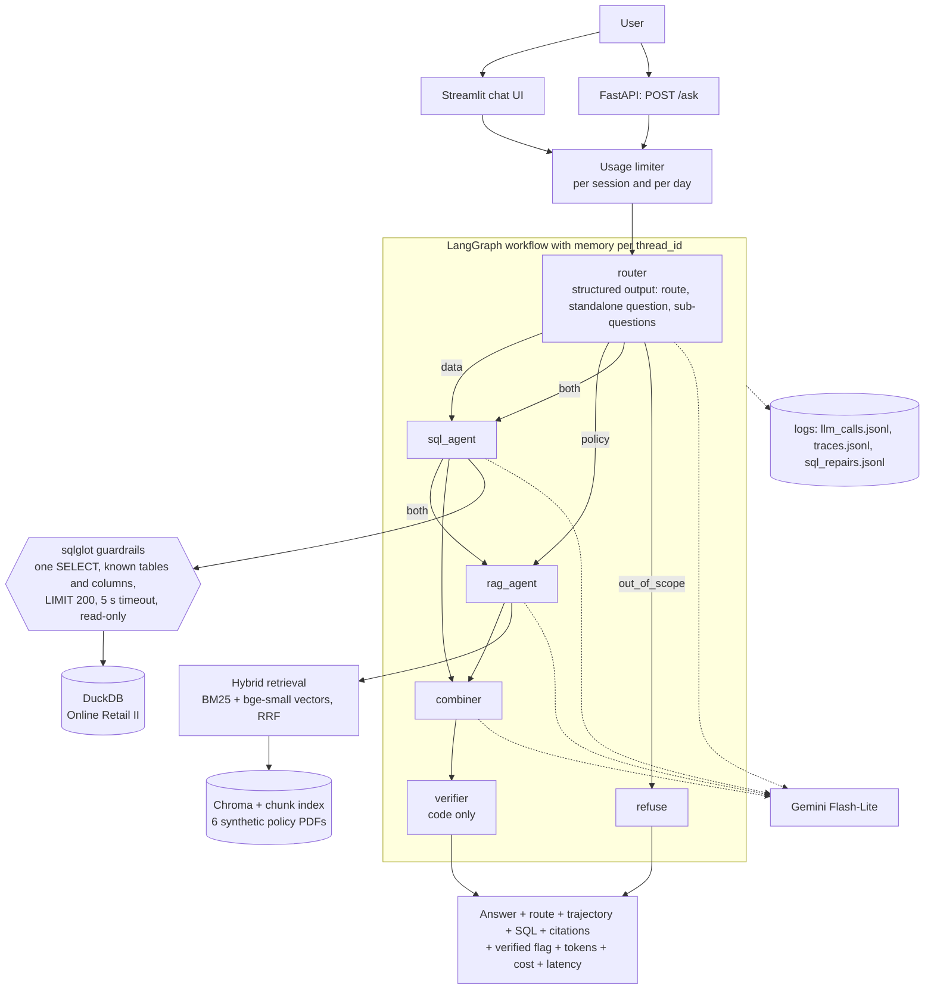

# Retail Insights Agent

A business user asks questions in plain English about a retail company. A LangGraph multi-agent system answers them. Data questions go to a SQL agent that writes safe, read-only SQL. Policy questions go to a RAG agent that answers with citations. A verifier written in plain code checks every number and every citation before an answer is shown.

Design principle: **the LLM decides and explains. Code does the maths and checks the facts.**

This is a portfolio project. It was built to show retrieval, text-to-SQL, agent orchestration, evaluation and observability end to end, with honest numbers.

**Live demo:** not deployed yet. The exact steps are in [docs/DEPLOY.md](docs/DEPLOY.md). Until then you can run it locally (below).

> **The policy documents are synthetic.** Northwind Gifts is a fictional company. The six policy documents in `data/docs/` were written for this demo, so the rules are specific and testable. They are not real company policies. The sales data is the real UCI "Online Retail II" dataset (a UK online gift retailer, December 2009 to December 2011).

## What it does

| Question type | Example | What happens |
|---|---|---|
| Data | "What were the top 5 products by revenue in November 2011?" | The SQL agent writes a read-only query. Code validates it and runs it. The agent explains the rows. |
| Policy | "Can a wholesale customer return a damaged item after 40 days?" | Hybrid search finds policy clauses. The RAG agent answers only from them, with citations like `[Returns and Refunds §7.4, p.2]`. |
| Both | "How many orders were returned in December 2010, and how long do retail customers have to return an item?" | The router splits the question. Both agents answer. A combiner joins the answers. |
| Out of scope | "What is the weather in London tomorrow?" | A polite refusal. No agent runs. |

Follow-up questions work within a conversation ("And in December?"), because the router rewrites each question to stand alone using the chat history.

## Architecture



How the pieces fit:

- **Router** returns a Pydantic object: the route, a standalone version of the question, and one sub-question per agent for mixed questions.
- **SQL agent** is guarded in code, not in the prompt. `sqlglot` allows one `SELECT` over known tables and columns only, blocks file and system functions, rejects made-up numeric constants in the top-level select list, adds `LIMIT 200`, and the query runs read-only with a 5 second timeout. A failed query is given back to the model once for a repair, and the reason is logged.
- **RAG agent** retrieves 5 clauses (BM25 plus vector search, fused with reciprocal rank fusion) and may answer only from them.
- **Verifier** removes any sentence whose number is not in the SQL rows, the cited clause or the question, or whose citation does not match a retrieved clause. What it removes is logged.
- **Tracing** logs every model call (tokens, cost, latency, cache hit) and every request (route, trajectory, verified flag, totals). Langfuse is used only if its keys are set.

## Run it locally

You need Python 3.11 and a free Gemini API key from Google AI Studio.

```bash
python -m venv .venv
.venv/Scripts/activate            # Windows. On Linux or macOS: source .venv/bin/activate
pip install -r requirements.txt
pip install -e .
cp .env.example .env              # then put your key in GOOGLE_API_KEY
```

The sales database and the vector index are rebuilt automatically on first start from files in the repository (`data/deploy/*.parquet` and `data/docs/*.pdf`). The first start downloads the small embedding model.

```bash
streamlit run app/streamlit_app.py          # chat UI (runs the agent inside the Streamlit process)
uvicorn ria.api:app --port 8000             # REST API: POST /ask, GET /health, GET /limits, GET /examples
pytest                                      # offline tests, no API calls
```

Docker (FastAPI on 8000 and Streamlit on 8501 in one container). I wrote this Dockerfile but could not build it on my machine because Docker Desktop was not running, so it is **untested**:

```bash
docker build -t retail-insights-agent .
docker run --rm -p 8501:8501 -p 8000:8000 -e GOOGLE_API_KEY=your-key retail-insights-agent
```

API example:

```bash
curl -X POST http://localhost:8000/ask -H "Content-Type: application/json" \
  -d '{"question": "How many orders were returned in December 2010?", "thread_id": "demo-1"}'
```

The answer has: `answer`, `route`, `trajectory`, `sql` (with columns and rows), `citations` (with the cited passages), `verified`, `removed`, `tokens`, `cost_usd`, `latency_s`. Errors are clear: 422 for a bad question, 429 when a usage limit is reached, 503 when the model's free daily quota is used up.

### Protecting the free quota on a public demo

A public demo on a free Gemini key can be drained by a few visitors. So live questions are limited: 5 per visitor and 60 per day for the whole demo by default (`RIA_SESSION_LIMIT`, `RIA_DAILY_LIMIT`). Days follow US Pacific time, because that is when the Gemini free quota resets. If Gemini itself reports its daily quota is used up, live questions pause until the reset. When a limit is reached the user sees a clear message. The UI also has **20 pre-computed examples** from real runs of this system (see below) that open with no quota use.

## Results

The tables below are copied from [docs/results.md](docs/results.md) by `scripts/sync_readme.py`. Numbers in the text come from those tables or from `python scripts/doc_facts.py`, which reads only saved run files. The model for every answering component is `gemini-3.5-flash-lite`. Details, commands and caveats for each number are in `docs/results.md`.

### Eval v1 (frozen, git tag `eval-v1`)

20 held-out questions (written before any run and never used for tuning) and 37 dev questions (used while building, so optimistic). **Held-out is the headline.** Eval v1 is frozen: the code refuses to overwrite its results.

**Gates** (must pass):

<!-- BEGIN sync:eval_v1_gates -->
| Gate | Result | Detail |
|---|---|---|
| No unsupported number or citation in a final answer (verifier re-run on every answer) | PASS | heldout 16/16, dev 36/36 |
| All out of scope questions refused | PASS | heldout 4/4, dev 1/1 |
| SQL guardrail blocks every unsafe query | PASS | 51/51 unsafe queries blocked (`evals/unsafe_sql.json`, no model involved) |
<!-- END sync:eval_v1_gates -->

**Observations:**

<!-- BEGIN sync:eval_v1_obs -->
| Metric | Held-out | Dev |
|---|---|---|
| Router accuracy (route matches expected) | 20/20 = 100% (95% CI low 84%) | 35/37 = 95% |
| Trajectory accuracy (exact node sequence) | 20/20 = 100% (95% CI low 84%) | 35/37 = 95% |
| SQL execution accuracy (data and both questions, 0.5% tolerance) | 10/10 = 100% (95% CI low 72%) | 15/16 = 94% |
| Retrieval recall@5 (policy and both questions, end to end) | 10/10 = 100% (95% CI low 72%) | 20/21 = 95% |
| Refusal rate on out of scope questions | 4/4 = 100% (95% CI low 51%) | 1/1 = 100% |
| Judge faithfulness, mean 1 to 5 | 4.94 (n=16) | 4.92 (n=36) |
| Judge answer relevance, mean 1 to 5 | 5.00 (n=16) | 5.00 (n=36) |
| Judge says faithful (faithfulness 4 or 5) | 100% | 100% |
| Answers the verifier changed | 0/16 | 0/36 |
| Sentences removed (number / citation) | 0 / 0 | 0 / 0 |
| Median wall time per question (s, includes pacing gaps) | 10.4 | 11.2 |
<!-- END sync:eval_v1_obs -->

How to read this honestly:

- A perfect score on a small set proves little. The table shows the 95% lower bounds: 84% for 20 of 20 and 72% for 10 of 10.
- The verifier changed 0 of 52 real answers, so gate 1 shows the final answers are stable under the verifier's rules. It does not show that the verifier catches the model's mistakes. That is shown only by unit tests and a fault-injection test.
- The judge was a different model for 15 of the 16 held-out answers and the answering model itself for everything else (the free daily quota of the other judge models ran out). Its relevance score of 5.00 on every answer is not credible.
- Judge calibration against human labels is **pending**: it needs the 20 hand labels in `evals/human_labels.jsonl`.

### Eval v2 (pending)

A second, harder held-out set of 20 questions (`evals/questions_v2.jsonl`) was committed in `da8dea5` before any run and before the router and prompt fixes. Git history shows `da8dea5` comes before the fix commit `83cea5a`. The fixes were made using dev questions only. **It has not been run yet**, because the free daily quota ran out. The dev re-run after the fixes is also unfinished. So the effect of the fixes is **unmeasured**. The commands to finish are at the end of `docs/results.md`. Eval v1 stays untouched.

### Token economics

Per route, on the 20 held-out questions, at paid-tier list prices (the free tier bills nothing). The prices in `config.PRICES` were compared with the official Gemini pricing page on 2026-10-25 (found during development, raw output not saved). Thinking tokens are billed as output.

<!-- BEGIN sync:tokens_route -->
| Route | Requests | LLM calls per query | Avg input tokens | Avg output tokens | Avg total tokens | Cost per query | Cost per 1,000 queries |
|---|---|---|---|---|---|---|---|
| data | 6 | 3.0 | 1421 | 160 | 1581 | $0.000827 | $0.827 |
| policy | 6 | 2.0 | 898 | 645 | 1543 | $0.001881 | $1.881 |
| both | 4 | 5.0 | 2117 | 1432 | 3548 | $0.004214 | $4.214 |
| out_of_scope | 4 | 1.0 | 365 | 66 | 431 | $0.000275 | $0.275 |
| **all (this mix)** | 20 | 2.7 | 1192 | 541 | 1733 | $0.001710 | $1.710 |
<!-- END sync:tokens_route -->

Share of tokens spent on the schema and on retrieved context:

<!-- BEGIN sync:tokens_share -->
| Part of the prompt | Tokens | Share of input tokens | Share of all tokens (input + output) |
|---|---|---|---|
| Schema description (sent in every SQL write call) | 5800 | 24.3% | 16.7% |
| Few-shot SQL examples | 2070 | 8.7% | 6.0% |
| Other SQL instructions and rules | 890 | 3.7% | 2.6% |
| Retrieved policy context (5 passages in every RAG call) | 2664 | 11.2% | 7.7% |
<!-- END sync:tokens_share -->

Output tokens are 79.1% of the cost in this run (`python scripts/doc_facts.py`), so the biggest lever is thinking effort, not the prompt.

### The caching finding

I restructured the prompts so the long, stable part (instructions, schema, few-shot examples) comes first and the question last, then compared with a question-first layout on the same 20 questions, cache off.

<!-- BEGIN sync:caching_main -->
| Layout | Queries | LLM calls | Input tokens | Cached input tokens | Cost per query | Cost per 1,000 queries | Median call latency (s) | Median model time per query (s) |
|---|---|---|---|---|---|---|---|---|
| question_first (before) | 20 | 54 | 23882 | 0 (0.0%) | $0.001795 | $1.795 | 1.38 | 4.00 |
| stable_first (after) | 20 | 54 | 23839 | 0 (0.0%) | $0.001710 | $1.710 | 1.26 | 3.47 |
<!-- END sync:caching_main -->

**Caching did not trigger.** Cached tokens were 0 in both layouts, and also when the identical 894-token SQL prompt was sent four times in a row:

<!-- BEGIN sync:caching_probe -->
| Call | Input tokens | Cached tokens | Latency (s) |
|---|---|---|---|
| 1 | 894 | 0 | 1.09 |
| 2 | 894 | 0 | 0.78 |
| 3 | 894 | 0 | 1.27 |
| 4 | 894 | 0 | 1.21 |
<!-- END sync:caching_probe -->

Gemini explicit caching was refused. The API reports a 1,024-token minimum and a free-tier storage limit of 0:

<!-- BEGIN sync:explicit_cache -->
| Model | Prompt | Prompt tokens | Result |
|---|---|---|---|
| `gemini-3.5-flash-lite` | SQL system prompt | 876 | cache NOT created: ClientError: 400 INVALID_ARGUMENT. {'error': {'code': 400, 'message': 'Cached content is too small. total_token_count=879, min_total_token_count=1024', 'status': 'INVALID_ARGUMENT'}} |
| `gemini-3.6-flash` | SQL system prompt | 876 | cache NOT created: ClientError: 400 INVALID_ARGUMENT. {'error': {'code': 400, 'message': 'Cached content is too small. total_token_count=879, min_total_token_count=1024', 'status': 'INVALID_ARGUMENT'}} |
| `gemini-3.5-flash-lite` | padded prompt (synthetic: schema repeated once) | 1465 | cache NOT created: ClientError: 429 RESOURCE_EXHAUSTED. {'error': {'code': 429, 'message': 'TotalCachedContentStorageTokensPerModelFreeTier limit exceeded for model gemini-3.5-flash-lite: limit=0, requested=1468', 'status': 'RESOURCE_EXHAUSTED'}} |
<!-- END sync:explicit_cache -->

The small cost and latency difference between the two layouts is not a caching effect. Input tokens were almost identical, and the difference is output-token and latency noise. Even perfect input caching could save at most 18.8% of the cost (`python scripts/doc_facts.py`). One more disclosure (found during development, raw output not saved): the question-first baseline was applied to the router and SQL prompts only, because a patch of mine silently missed the RAG prompt. That does not change the conclusion.

### Pre-computed examples in the demo

`data/examples/examples_v1.json` holds the 20 eval-v1 held-out questions with the answer, route, trajectory, SQL, citations, verified flag, tokens, cost and latency recorded in a real run (`scripts/build_examples.py`, no hand edits). One of the 20 is a wrong answer (the model added a filter that excluded postage, so its number differs from the gold answer). It is kept and labelled as such in the UI.

## Limits

- **The policy documents are synthetic.** The system has never seen real company policies. The sales data covers 2009 to 2011 only.
- **The eval sets are small.** 20 held-out questions and 37 dev questions. Route groups have 4 to 6 questions. Confidence intervals are wide. The dev numbers are optimistic. Dev both and out-of-scope sets have one question each.
- **The model is not deterministic.** The model ignores temperature 0. The same 10 held-out SQL questions scored 10 of 10, 10 of 10 and 9 of 10 in three runs (`python scripts/doc_facts.py`). Single-run accuracy has noise I have not measured.
- **Self-judging.** Most dev answers were scored by the answering model. Judge scores are lenient and not yet calibrated against human labels.
- **The verifier is narrow.** It checks numbers and citation ids only, not meaning. It trusts the SQL rows. It ignores numbers written as words. It allows numbers that appear in the cited clause or in the question.
- **Known weaknesses.** One policy question (p10) still misses its gold clause. If the SQL agent's explanation step fails, the answer is a safe message plus the result rows instead of a written explanation. Two dev policy questions were routed to the wrong path before the router fix, whose effect is unmeasured. The RAG prompt used to add "for a retail customer" to answers (judged unsupported); the fix is unmeasured.
- **Free tier limits.** The API's own error message gives a free limit of 500 requests a day for the answering model (`python scripts/doc_facts.py`). Latency swings with API load. Explicit context caching is not available on the free tier.
- **Prices** in `config.PRICES` were taken from the official pricing page on 2026-10-25 and will change.
- **Memory.** The agent plus the embedding model came close to the documented minimum memory of Streamlit Community Cloud on my machine (found during development, raw output not saved), so a deployment there may be unstable.
- **Not tested here:** the Dockerfile, the GitHub Actions nightly job on GitHub itself, Langfuse against a live account, and the Streamlit Cloud deployment. A clean clone was started locally with `scripts/start.sh` (found during development, raw output not saved). See `docs/DEPLOY.md` and the Phase 6 section of `docs/results.md`.

## What I would do next

1. Run eval v2 and the dev re-run after the quota resets, and report v2 separately from v1.
2. Fill in the 20 human labels and measure how well the judge agrees with a human.
3. Cut cost where it is: lower the thinking effort of the RAG and combiner calls and measure the quality change.
4. Fix the p10 retrieval miss (a better query rewrite or a reranker trained on this domain), judged by a held-out set.
5. Run each eval several times and report the spread, to measure model nondeterminism.
6. Add a human review step for answers the verifier changed, and track the share of changed answers in production.
7. Use a paid key for the public demo, which also allows context caching.

## Reproduce the results

```bash
python -m ria.make_policy_pdfs         # Markdown -> PDF (the PDFs are also committed)
python -m ria.ingest_docs              # PDFs -> chunks -> embeddings -> Chroma
python -I -m ria.sql_db                # load the UCI dataset into DuckDB (download it first, see below)
python scripts/export_deploy_data.py   # parquet copies used to rebuild the database on a host
python evals/retrieval_eval.py         # retrieval comparison (no model calls)
python evals/sql_eval.py               # SQL execution accuracy, 15 dev questions
python evals/run_evals.py              # full eval v1 (cache off). New runs use --label, eval_v1 is frozen
python evals/caching_experiment.py     # caching experiment, 20 held-out questions
python evals/token_report.py           # tokens and cost per route
python scripts/build_examples.py       # pre-computed examples for the demo (no model calls)
python scripts/sync_readme.py          # copy result tables into this README
```

Download the dataset from https://archive.ics.uci.edu/dataset/502/online+retail+ii into `data/raw/online_retail_ii/` first. See the dataset page for its license and citation.

Project layout: `src/ria/` (the code), `app/streamlit_app.py` (UI), `evals/` (questions, eval scripts, runs), `docs/results.md` (every measured number and its command), `docs/DEPLOY.md` (deployment steps), `tests/` (offline tests), `.github/workflows/nightly-eval.yml` (nightly gates, also runnable by hand from the Actions tab).
